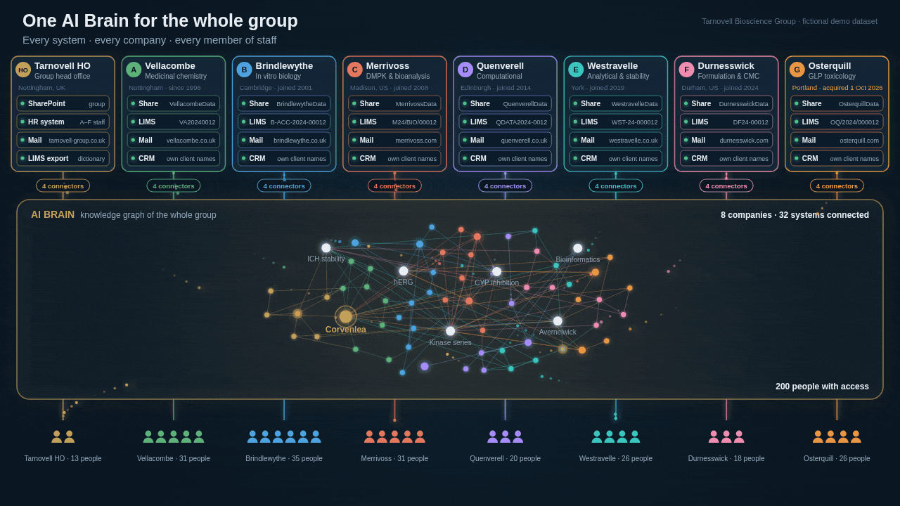
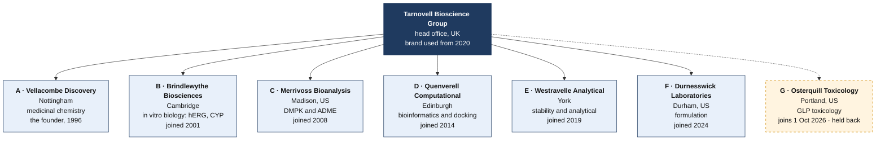
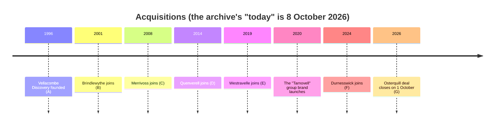
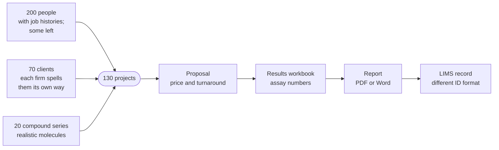
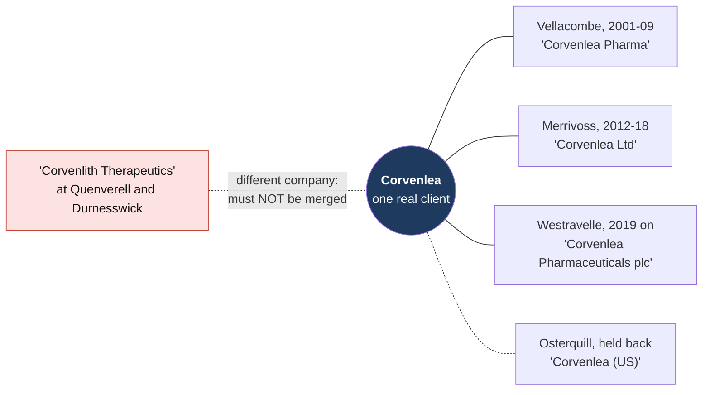
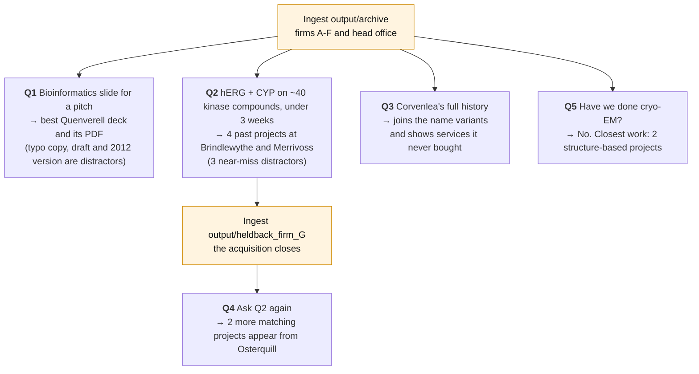

# portco-mock-dataset

A fictional document archive for demoing AI Brain on a buy-and-build portfolio company (DEV-1369, DEV-1370). Everything in it is invented: the firms, people, clients, compounds, projects and results.



The animation's source is [`docs/architecture/ai-brain-architecture.html`](docs/architecture/ai-brain-architecture.html); regenerate the GIF with `uv run --script docs/architecture/render.py`.

- **Ready to ingest:** the eight zips in `tarnovell_archive/` first (306 files, one zip per top-level folder; select them all in one upload), then `tarnovell_firm_G_heldback.zip` (34 files, firm G) for the acquisition step. Every zip is under AI Brain's 30 MB upload limit; the archive as one zip (49 MB) is not. Unzipped sources: `output/archive/` and `output/heldback_firm_G/`.
- **Why firm G is held back:** buy-and-build groups keep acquiring, so the demo needs to show what happens the day a new company's archive lands. Firm G (Osterquill Toxicology) is the newest acquisition, closing on 1 October 2026. You ingest the main archive and ask a question, then ingest firm G and ask the same question again. New answers appear straight away: two more matching projects, and a client record ("Corvenlea (US)") that links to the group's existing Corvenlea history. That shows AI Brain makes a newly bought firm's knowledge usable from day one, without any integration work.
- **Answer key:** `output/golden_set.json`. Don't ingest it.
- **How it was made and how to regenerate it:** [`docs/datasheet.md`](docs/datasheet.md).
- **Next generation run:** start with the [generation workflow](#generating-and-reviewing-content) below. [`briefs/orchestration.md`](briefs/orchestration.md) has the full dispatch and recovery procedure.

## Generating and reviewing content

The generation safeguards added in [PR #2](https://github.com/60xAI/portco-mock-dataset/pull/2) help catch source contradictions, prevent overlapping Git operations, and check each writer tier before bulk work. Run commands from the repository root and read [`briefs/stage7-content.md`](briefs/stage7-content.md) before writing.

1. Run `uv run mockgen preflight` and resolve every source error. Keep the world, number tables, manifests, price rules and exemplars fixed while writers run.
2. Pilot each writer tier with its own configured target before bulk dispatch. The current policy requires 10 original submissions, at least 9 `ok` or `minor` verdicts, at most 1 `fix`, no source contradictions, and accepted resubmissions for every fix. Save original verdicts in `critique/pilot-<tier>.yaml` and the decision in `docs/generation-run.md`. The orchestrator approves this gate; `mockgen next` enforces routing. A failed tier's remaining work must move to the stronger tier through `writer_policy.promoted_tiers`.
3. Claim work, obtain each file's pack, write content using its exact names and tables, then submit with the fingerprint printed in that pack:

   ```sh
   uv run mockgen next --tier <tier> --batch 6 --who <writer>
   uv run mockgen pack <file-id>
   uv run mockgen submit <file-id> content/<file-id>.json --source <pack-fingerprint>
   uv run mockgen commit <file-id>
   ```

   Targets and limits live in [`config/models.yaml`](config/models.yaml). Scientific workbooks, reports, readouts, pricing and scientific copies use the stronger tier. Cheaper tiers handle bounded administrative content and junk. Near the end, `next` fills batches across firms and document families within a tier, while respecting explicit filters and source-copy dependencies.
4. Review all pilots, planted answers and cheap-tier files using [`briefs/critique.md`](briefs/critique.md). Apply fixes using [`briefs/stage8-review-fix.md`](briefs/stage8-review-fix.md), then resubmit them. Preserve the original pilot verdicts.

Accepted submissions record their source fingerprint in `content/<file-id>.source.json`. Finish with `uv run mockgen sources changed` and `uv run mockgen validate --all`. Changed sources require content review and resubmission against a current pack. Existing files without a receipt have untracked provenance and need the same review. Obtaining a new pack or re-rendering a file does not establish that its content matches the current sources.

During parallel work, use `mockgen commit <file-id>` for accepted content and `mockgen commit --path <exact-file> -m "<message>"` for review or source artifacts. Commit and sync share `state/git.lock`; avoid raw Git mutations during the run. Routine `uv run mockgen sync` allows only a fast-forward and refuses dirty trees or active claims. After a rejected push, stop dispatch, drain writers, commit their named files with `--no-push`, resolve or release claims, and clean the tree before `uv run mockgen sync --rebase`. Follow the [full recovery procedure](briefs/orchestration.md#git-coordination) before retrying the push.

## The fake world

**Tarnovell Bioscience Group** is a contract research group built over 30 years by buying small specialist labs. Each lab kept its own shared drive, file-naming habits and client names, so the group's knowledge is scattered across seven legacy archives. Finding it is the problem AI Brain solves in the demo.

### The group



### How it grew



Before 2020 the group was simply "the Vellacombe group". Older files keep their original firm's look, names and date formats.

### What lives in it



Around the projects sit capability decks, SOPs, trackers, price lists, memos, board packs, scanned signed reports, legacy .ppt/.xls/.doc files and junk (empty templates, "Copy of" files, leavers' old laptops). Assay numbers come from models trained on public ADMET data, so they look real to a scientist.

### One client, many names

The key client, **Corvenlea**, appears under a different name at each firm that worked with it. A lookalike company is the trap.



The head office's client identity bridge and white-space matrix name these variants together, which is what lets AI Brain join them up.

## The demo



Each question has a planted answer. `output/golden_set.json` gives the expected files and the page or slide each answer is on.

### Packaging for ingestion

File dates are part of the realism and zips keep them. `uv run mockgen zips` restores the dates (git doesn't store them; it runs `mockgen export` first), then rebuilds `tarnovell_archive/*.zip` and `tarnovell_firm_G_heldback.zip`. It fails if any zip reaches the 30 MB upload limit.

All names were screened so they don't clash with real companies or people.
